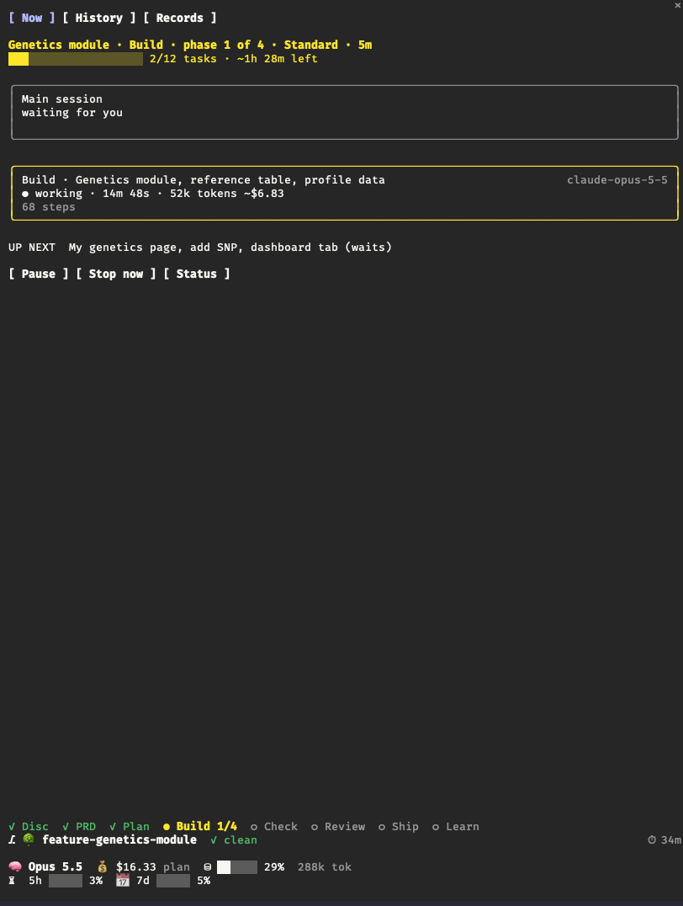

# Cairn: Repeatable SDLC Workflows

A Claude Code plugin for an agent-driven software development lifecycle. This repository is also its marketplace, so you can install it straight from GitHub.

cairn takes a feature from an idea to a shipped, recorded change in the same fixed steps every time:

```
Discover → PRD → Plan → Build → Check → Review → Ship → Learn
```

Agents do the work. You make the calls that matter: approving the PRD, the plan, and the ship.

A small CLI owns each plan's state, so you always know three things: where a plan stands, what's done, and what's next. You can stop at any point and pick up exactly where you left off, in a new session if you like.

## Why it exists

Workflow plugins such as Compound Engineering and Superpowers describe their stages in prose that the model may or may not follow, and they let the session that shaped a plan also judge it. That leads to five problems:

- Long plans drift.
- Steps get skipped.
- There's no single view of where a plan stands.
- Every run costs a lot of tests, reviews, and gates, whether or not the change needs them.
- The session that shaped a plan is the one judging it, so a wrong direction goes unchallenged.

cairn fixes this in five ways:

- **A script owns the state.** The stage, phases, tasks, approvals, and test results live in a `state.json` that only the `cairn` CLI writes. The CLI refuses a move when its proof is missing, and it names the fix.
- **Effort you choose.** Each plan starts at a **level**: MVP to prototype fast, Standard for normal work, or Polished for the deepest checks. At Standard every task gets tests for its core logic and a reviewer, the full test suite runs before each merge, and **risky** tasks (auth, money, deleting data, migrations, public APIs) also get thorough tests and a security review. Everything else worth doing later goes into a list of **recommended follow-ups**, and cairn offers them back when you next touch the same code.
- **You can see it working.** A live pane beside the chat shows a card for every running agent: what it's doing, how long it's taken, and roughly how long is left.
- **Parallel, isolated work.** Each plan runs on its own branch and worktree, and each task on its own branch and worktree. Tasks that don't touch the same files run in parallel, up to 3 at a time.
- **Fresh eyes before you commit.** Before you approve the PRD, agents that never saw the interview challenge the direction and check that the PRD stands on its own. See Fresh eyes.

## Requirements

- Claude Code v2.1.287 or later, for the mod that powers the pane, menu approvals, and pause.
- Node.js **20+**. The CLI is a single bundled file with no dependencies.
- Git. Plans live on branches and worktrees.
- For the full-height side pane: Claude Code's fullscreen layout, `"tui": "fullscreen"` in `~/.claude/settings.json`, or run `/tui fullscreen` once. In the normal layout the pane sits above the prompt as a compact summary.

## Install

In a Claude Code session:

```
/plugin marketplace add jason-flenniken/cairn
/plugin install cairn@cairn
```

Or from your shell:

```
claude plugin marketplace add jason-flenniken/cairn
claude plugin install cairn@cairn
```

Then run `/reload-plugins`, or start a new session. The `cairn` CLI comes with the plugin: Claude Code puts it on the path of Claude's shell while the plugin is enabled, so there's nothing else to install.

Adding the marketplace clones this repository with your own `git`. It tries SSH first and falls back to HTTPS; on a machine with no GitHub SSH key, set `CLAUDE_CODE_PLUGIN_PREFER_HTTPS=1` to go straight to HTTPS.

cairn includes a **mod**, Claude Code code that runs inside the app: the pane, menu approvals, pause, and the guards that stop the model approving its own work. Like any mod it runs with your permissions. To see every event it handles and every call it makes before you install, clone the repo and run `claude plugin validate plugins/cairn`. See [Decide whether to trust a mod](https://code.claude.com/docs/en/plugins/mods/overview#decide-whether-to-trust-a-mod).

In any repo where you use cairn, turn off Superpowers and Compound Engineering. Their skills trigger on their own and compete with cairn's. A project-level `.claude/settings.json` can do it:

```json
{
  "enabledPlugins": {
    "compound-engineering@compound-engineering-plugin": false,
    "superpowers@claude-plugins-official": false
  }
}
```

### Update

A new release reaches you when its version changes. Auto-update is off for marketplaces you add yourself, so update by hand:

```
/plugin marketplace update cairn
```

or `claude plugin update cairn@cairn` from your shell, then `/reload-plugins`. To get releases automatically, open `/plugin`, go to **Marketplaces**, select `cairn`, and choose **Enable auto-update**.

## Quick start

1. **Start a plan.** Inside the repo you want to work on, run:

   ```
   /cairn:new add a CSV export to the reports page
   ```

   cairn creates a branch (`feature/<slug>`) and a worktree for the plan. If the repo has no `.cairn/config.json`, cairn detects your test and build commands from `package.json`, a `Makefile`, `pyproject.toml` and the like, asks you to confirm them, and commits the file. Then the discovery interview starts.
2. **Answer the interview.** It asks one question at a time, each with a recommended answer. Every answer is written to the plan's `decisions.md`.
3. **Approve the PRD**, then **approve the plan**, from the menu.
4. **Let it build.** Phases run on their own. Tasks run in parallel, get merged, and are tested. A phase that finishes with passing tests rolls straight into the next one.
5. **Approve the ship.** cairn writes a one-page record of what was built and why.

When you're unsure what to do, run **`/cairn:next`**. It does the one correct next thing for the plan you're in, and it's the only command you need to remember.

## Commands

| Command | What it does |
|---|---|
| `/cairn:next` | Does the next thing for the current plan, whatever stage it's in. |
| `/cairn:new <idea>` | Starts a plan: its branch and worktree, the repo config if missing, then the discovery interview. |
| `/cairn:status` | Shows every plan: stage, what's done, what's next, what's blocked, what's waiting on you. |
| `/cairn:pause` / `/cairn:resume` | Pauses cleanly with a handoff note, and later picks up exactly there. |
| `/cairn:fix <bug>` | The quick lane for one bug: failing repro first, then the fix, then a short record. |
| `/cairn:suggestions` | Lists recommended follow-ups from every plan. Turn one into a fix, add it to the current plan, or dismiss it. |
| `/cairn:direction` | An on-demand on-track check: compares the code to the PRD and reports green, yellow, or red per requirement. |
| `/cairn:product` | Writes the whole-app product PRD (`docs/cairn/product/`) that every plan inherits. |
| `/cairn:discover`, `/cairn:prd`, `/cairn:plan`, `/cairn:execute` | Run one stage directly. `/cairn:next` normally picks these for you. |

The mod adds these commands, which run instantly without a Claude turn:

| Command | What it does |
|---|---|
| `/cairn-pane [on\|off]` | Shows or hides the live pane. With no word it toggles. Your choice sticks across sessions, and closing the pane by hand also turns it off. |
| `/cairn-approve [prd\|plan\|ship]` | Approves the stop the current plan is waiting on. |
| `/cairn-level` | Changes the current plan's level. Offers only the levels the plan can move to. |
| `/cairn-pause-mod` | Pauses once in-flight work reaches a safe point. |
| `/cairn-pause-now` | Stops the running turn and pauses right away. |
| `/cairn-resume-mod [plan]` | Resumes a paused plan, even after `/clear`. |

## The lifecycle

| Stage | What happens | Stops for you? |
|---|---|---|
| **Discover** | An interview, one decision at a time, covering users, the core flow, non-goals, and anything risky. Facts come from the codebase first, so the questions are only real decisions. A fresh agent that never saw cairn's guess offers other approaches and the strongest objection, and anything it raises that's yours to decide becomes a question. | No |
| **PRD** | A short PRD: Problem, Solution, Requirements (each with a one-line check), Non-goals, Open questions. Unhappy paths, security, and performance sections appear only when they matter. Before you see it, a fresh agent reads only the PRD and lists what a builder would have to guess. | **Yes: approve the PRD** |
| **Plan** | The PRD is broken into phases of small vertical **tasks**. Each task lists its files, what it waits on, its size (which picks the model), and whether it's risky. Recommended follow-ups that touch the same files are offered as extra tasks. | **Yes: approve the plan** |
| **Build** | Ready tasks start in parallel, each in its own worktree with a fresh agent. Each one writes tests for its core logic and gets a reviewer. Risky tasks also get thorough tests and a security review, with at most two fix attempts before cairn asks you. Every task is merged and the full test suite runs. A finished phase continues on its own when tests pass. | Only if tests fail or something is blocked |
| **Check** | Tests and build, then one pass over the PRD's checks. A requirement that isn't met gets fixed. One that works but has no test becomes a recommended follow-up. | Only if something is broken |
| **Review** | One review of the whole branch. Blocking means a bug, a security hole, data loss, or an unmet requirement, and those are fixed in place. Everything else becomes a recommended follow-up. | Only if something is blocking |
| **Ship** | A one-page `RECORD.md`: links, why, what was built, how it works, follow-ups. | **Yes: approve the ship** |
| **Learn** | Checks the follow-ups are tidied, then closes the plan. It asks you nothing. | No |

The `cairn` CLI checks each move between stages. If something is missing, such as an approval, a required PRD section, or a passing test run, it refuses and prints the exact fix. You can overrule a refusal from an **Override** menu, and every override is logged with its reason.

The table above is the Standard level. See Depth levels for how MVP and Polished change each stage.

## Depth levels

`/cairn:new` asks how deep the whole plan should go, with your repo's `defaultLevel` picked first:

| Level | For | What changes |
|---|---|---|
| **MVP** | Prototyping fast, finding out if something is worth building | A short interview and thin PRD with no fresh-eyes agents, a few large tasks, no per-task review, tests that warn instead of block, one light branch review, and a short record. What it skips goes on a **hardening list**. |
| **Standard** | Normal work | The lifecycle above, as is. |
| **Polished** | Hardening what you'll keep | Three approaches compared before the PRD, test cases and test-first for every task, a fresh-agent review of the plan, an automatic on-track check at each phase end, and every requirement met and tested. |

Some things never change with the level: Check always runs the secret scan and dependency audit, any task touching a trust boundary gets a security review, the whole-branch security review always runs, and you still approve the PRD, the plan, and the ship.

The hardening list doesn't count toward the 5 follow-ups a plan may close with. When a later Standard or Polished plan touches the same code, cairn offers those items as scope, so moving past an MVP is one deliberate run.

You can raise the level any time before ship with `/cairn-level` in the pane, and lower it only before any task starts. The pane header shows the level and how long the current stage has taken. Only you change the level; cairn can suggest a raise, but the change needs your pick in a menu or `cairn level <level> --human` in a terminal.

## Fresh eyes

The session that runs your interview builds up a lot of context: your answers, the codebase facts, and its own guess at what you want. That context is what makes the plan good, and it's also what makes the session a poor judge of it. Once it has argued for one approach, it struggles to see past it. cairn's other reviewers check work against the PRD, so none of them can catch a PRD that points the wrong way, and the start of a plan is where a wrong direction costs the most.

So at Standard and Polished, two agents that start with no memory of the conversation look at the plan before you approve the PRD. What makes each one useful is what it's *not* given:

| Agent | When | Sees | Doesn't see | Looks for |
|---|---|---|---|---|
| Challenger | Discover, after the goal questions | Your goal answers and the research facts | cairn's guess, or the outcome it's heading toward | Other approaches (including not building it, or reusing what exists), the strongest objection to the obvious one, and assumptions nobody stated |
| Builder check | PRD, before you approve it | `prd.md` alone | The interview and `decisions.md` | Whether the PRD stands on its own: it restates the PRD in its own words and lists what a builder would have to guess |

Both return a list, not a pass or fail, because a reviewer asked for a verdict tends to talk itself into approving. Both are told to skip style and anything already decided, and to rank what they find by whether it would change what gets built, because a reviewer asked to find problems always finds something. At Polished the challenger compares three approaches, each with its cost and risk.

**What you see.** Neither adds a stop. What's yours to decide comes to you as ordinary interview questions, or as questions while the PRD is drafted. Everything cairn sets aside (already answered, or a minor call it made itself) gets a one-line reason in `decisions.md` and is listed under the read-back card or at the PRD approval, so you can pull any of it back. cairn may skip the challenger when a plan has one obvious approach (a one-line change), but the card then says so and why, and you can ask for it. That rule is what makes this work: the main session sorts the findings, and without it, the bias the fresh agent was there to counter could quietly drop the inconvenient ones.

**Cost and limits.** About two Sonnet passes per plan; MVP skips both. A fresh agent gives you a second view, not a smarter one: it's the same kind of model without your backstory. Fresh eyes on the finished code (a reader that sees the diff but not the PRD) are planned next.

The idea comes from Dave Rensin's essay [Elephants, Goldfish and the New Golden Age of Software Engineering](https://medium.com/@drensin/elephants-goldfish-and-the-new-golden-age-of-software-engineering-c33641a48874) and Google's [Elephant-Goldfish Model](https://github.com/google/elephant-goldfish-model) plugin: design with an elephant that never forgets, test with a goldfish that remembers nothing. cairn takes the theory, not the plugin. It adds no review rounds or stops, and it splits agents by what they aren't told rather than by persona, following Anthropic's advice to [split subagents by context, not by problem type](https://claude.com/blog/building-agents-when-to-fold-subagents-into-your-main-agent-loop). Anthropic's [harness design post](https://www.anthropic.com/engineering/harness-design-long-running-apps) makes the same case for keeping the agent that judges separate from the one that built.

## The live pane



The pane opens on its own at the start of every session, docked on the right in fullscreen (`/tui fullscreen`). In the normal layout it sits above the prompt as a compact summary. `/cairn-pane on|off` shows or hides it, and the choice sticks across sessions; closing it by hand turns it off too. Everything in it is read from the plan's state, so it's right even after a pause, a crash, or a new session.

It has three tabs, **Now**, **History**, and **Records**, and the same bar along the bottom of each.

### Now

- **Header:** the plan, its stage and phase, its level, and how long the current stage has run. Below it, a progress bar of tasks done and a rough time left, estimated from how long tasks of each size have taken so far, split across the parallel slots.
- **Waiting on you:** a yellow box, only when something needs you.
  - At the PRD, plan, and ship stops it shows the document's summary with **Read all**, which opens the full document in the pane, and **Approve**. Approve asks you to confirm, then records the approval the same way answering in the chat does. The model can't approve for you: the mod blocks it from running the approval itself.
  - During discovery it shows the read-back card while "Is this right?" is open in the chat, with buttons that answer it.
- **Main session:** what the orchestrating session is doing (running tests, merging, starting agents) and for how long. It turns yellow and says **waiting for you** only while it has asked you something in the chat; between turns it reads **idle**, with how many agents are still working.
- **Agent cards:** one per running agent: its role and task (Build, Review, Fix, Check, Record), model, time, tokens and estimated cost, current action, and step count. A finished card turns green (red if it stopped early) and stays a few seconds with its totals.
- **UP NEXT** lists the next tasks in the phase, marking those still waiting on another task. Files edited outside every task's scope show as **out-of-scope edits**.
- **Buttons:** **Pause** lets running work reach a safe point and stops, **Stop now** cuts the running turn and saves work in progress, **Resume** continues a paused plan, and **Status** prints where the plan stands.
- Other plans active in the repo are listed with a **Resume** button each.

### History

The plan's timeline, newest first, each line stamped with its time: stage moves, approvals, tasks done, phases finished, the check and review steps (reviewing, fixing, rechecking), escalations, level changes, pauses and resumes, and each agent that finished. Use it to see what happened while you were away.

### Records

Every plan in the repo: those still in progress at the top, then finished ones newest first, each with its date, title, and one-line why. Select a finished one to read its `RECORD.md` in the pane, with its open recommended follow-ups listed under it.

### The bar

Along the bottom of every tab:

- **Stage steps:** ✓ done, ● the current stage (with the phase during Build), ○ still to come.
- **Git:** the branch (🌳 when the session is in a worktree), `✓ clean` or the count of changed files, commits ahead ↑ and behind ↓, and the plan's active time ⏱: time counts only while the session or an agent is working, not while a question waits on you, the plan is paused, or the session sits idle.
- **Usage:** the model, what the plan has cost so far (or the session's total when no plan is active), how full the context window is, and the session's tokens.
- **Limits:** your 5-hour and 7-day usage. They change color as they get close, and show when they reset.

### Commands

| Command | What it does |
|---|---|
| `/cairn-pane [on\|off]` | Show, hide, or toggle the pane |
| `/cairn-approve [prd\|plan\|ship]` | Approve the stop the plan is waiting on, after a confirm |
| `/cairn-level` | Change the plan's depth level from a menu |
| `/cairn-pause-mod` | Pause once running work reaches a safe point |
| `/cairn-pause-now` | Stop the running turn and pause now |
| `/cairn-resume-mod [plan]` | Resume a paused plan, here or after `/clear` |

With no plan running, the pane still shows the agent cards and how to start a plan. The status line under the prompt carries a one-line version.

## Recommended follow-ups

cairn keeps quality work it chose not to do now as a list of recommended follow-ups. Each one has an area (tests, security, perf, quality, ux, docs), the files it concerns, and where it came from. They're logged by:

- the planner, for tests it skipped on low-risk tasks
- implementers and task reviewers, for minor findings
- Check and Review, for things that work but are untested or could be better

They never block anything. They come back to you at these points:

- **During planning,** when a new plan touches the same files: *"I recommend adding tests for the export parser (noted during the reports plan)"*. You choose: add it as a task, later, or dismiss.
- **In the summary line** at the end of each phase and at ship.
- **In the pane,** as a count.
- **On demand,** with `/cairn:suggestions`.

## Approvals and overrides

Approvals have to come from you, not from the model. Only you can provide either form of proof:

- **Menu (the usual way).** cairn asks with a menu, and the mod records the approval when *you* choose an option starting with "Approve", or type something like "approve", "yes", or "lgtm". Answers the model fills in itself, dialogs that time out while you're away, and menus inside subagents never count. The pane's Approve button and `/cairn-approve` work the same way.
- **Terminal (fallback).** When the mod isn't running, run `cairn approve <prd|plan|ship> --human` in your own terminal and type the plan's name.

Behind the scenes, the mod holds a one-time secret in memory and the CLI checks it against a hash on disk, so a used secret can't be replayed. Guards also stop the model from running `cairn approve` or editing plan state directly.

## Pause and resume

- **Pause** (`/cairn:pause`, the pane's Pause button, or `/cairn-pause-mod`) lets running work reach a safe point, then writes `handoff.md`: what's in flight, open questions, the next action.
- **Stop now** stops the current turn immediately and records where each task was.
- **Resume** (`/cairn:resume`, or the pane's Resume button) gives a short recap and continues with only the unfinished steps. After a long pause, cairn suggests starting in a fresh session so you aren't paying for a stale context.

## The bug-fix lane

`/cairn:fix <bug>` is a short, tracked plan for one bug:

1. **Repro first.** cairn records a command that fails because of the bug, and refuses to go on until it has one.
2. **The fix.** One task, which must make the repro pass with tests green.
3. **Review** of the fix, every time.
4. **A short record** of at most 200 words, then ship.

If the fix grows past 8 files, or turns out to need new requirements, `cairn escalate` turns it into a full plan.

## Configuration

Each repo has `.cairn/config.json`, which cairn creates the first time:

```json
{
  "setup": "npm ci",
  "test": "npm test",
  "build": "npm run build",
  "start": "npm run dev",
  "seed": "",
  "appTypes": ["web"],
  "maxParallel": 3,
  "resumeFreshAfterMinutes": 60,
  "autoCommit": true,
  "defaultLevel": "standard"
}
```

| Key | Meaning |
|---|---|
| `setup` | Runs in every new plan or task worktree, for example to install dependencies. |
| `test` | The full test command. It runs before each task is marked done, and again at Check and close. |
| `build` | The build command, run at Check. |
| `start`, `seed`, `appTypes` | How to run the app, seed its data, and what kind of app it is (`web`, `expo`, `api`). These are recorded for checks that drive the running app; the lean defaults don't use them yet. |
| `maxParallel` | How many tasks run at once (default 3). |
| `defaultLevel` | The level `/cairn:new` picks first: `mvp`, `standard` or `polished` (default standard). |
| `resumeFreshAfterMinutes` | How long a pause counts as recent before resume suggests a fresh session (default 60). |
| `fixMaxFiles` | How many files a bug fix may touch before cairn suggests a full plan (default 8). |
| `reproTimeoutMinutes` | How long a bug repro may run (default 10). |

The `setup`, `test`, and `build` commands are locked when you approve the plan. If they change mid-plan, cairn asks you to re-approve.

## Where things live

| What | Where |
|---|---|
| A feature plan's branch | `feature/<slug>`, in a worktree under `.claude/worktrees/` (folder `feature-<slug>`) |
| A fix plan's branch | `fix/<slug>`, in a worktree under `.claude/worktrees/` (folder `fix-<slug>`) |
| A plan's documents | `docs/cairn/plans/<date>-<slug>/` on the plan branch: `decisions.md`, `prd.md`, `plan.md`, `STATUS.md`, `handoff.md`, `RECORD.md`, `state.json` |
| A task's branch | `task/<slug>/<task>`, in its own worktree (folder: the plan folder plus `--<task>`, e.g. `feature-billing--cart-api`) |
| The product PRD | `docs/cairn/product/` on main |
| Repo config | `.cairn/config.json` |

When a plan ships, its branch merges back and its record lands on main with it.

## The CLI

Agents drive cairn through the `cairn` CLI. It is on the Bash tool's PATH while the plugin is enabled, and is also available as `node plugins/cairn/dist/cairn.mjs`. A few commands are handy by hand:

```
cairn status --all          # every plan, at a glance
cairn next                  # what to do now
cairn suggest list --open   # open recommended follow-ups
cairn approve plan --human  # approve from your own terminal
```

`cairn help` lists every command. The full contract is in `plugins/cairn/references/cli.md`: commands, what each move between stages requires, and JSON shapes.

## Developing cairn

To work on cairn itself, install it from your clone instead of GitHub, so your edits load in place with `/reload-plugins` and no version bump. Only one marketplace named `cairn` can be registered at a time, so remove the GitHub one first if you added it:

```
git clone https://github.com/jason-flenniken/cairn && cd cairn
claude plugin marketplace remove cairn        # only if you added it from GitHub
claude plugin marketplace add ./
claude plugin install cairn@cairn
```

Then:

```
npm install
npm run build        # bundles plugins/cairn/dist/cairn.mjs (committed)
npm run typecheck
npm test             # CLI tests (node:test) and the mod's tests (claude plugin test)
claude plugin validate plugins/cairn
```

```
plugins/cairn/
  cli/src/          the CLI (TypeScript), the only writer of plan state
  hooks/            the mod: register.tsx, plus mod/ (pane, agent tracking, approvals, pause, guards)
  procedures/       the step-by-step instructions for each stage; `cairn next` names the one to follow
  skills/           thin slash-command wrappers around the procedures
  agents/           implementer, task-, branch-, security- and plan-reviewer, challenger, prd-checker, acceptance- and direction-checker, recorder
  templates/        PRD, plan, record, handoff, config
  references/       CLI contract, reporting rules (plain words, output style), model tiers
```

- Changes to `hooks/` take effect after `/reload-plugins`.
- Changes to `cli/src/` need `npm run build`.
- Engine limits found while building the mod are in `plugins/cairn/hooks/NOTES.md`.
- The design history is in `docs/design.md`, and each plan's record is in `docs/cairn/plans/`.
- To rename the plugin: `plugins/cairn/scripts/rename.sh <name>`.
- To release: raise `version` in `plugins/cairn/.claude-plugin/plugin.json` and push to `main`. People who installed from GitHub only receive commits that change it.

## Credits

cairn adapts ideas, prompts, and procedures from [Compound Engineering](https://github.com/everyinc/compound-engineering-plugin), [Superpowers](https://github.com/obra/superpowers), and [Matt Pocock's skills](https://github.com/mattpocock/skills), all MIT-licensed. Their notices are in `plugins/cairn/NOTICE`, and the upstream commits are in `plugins/cairn/UPSTREAM.md`.

The fresh-eyes agents draw on the ideas in Dave Rensin's [essay](https://medium.com/@drensin/elephants-goldfish-and-the-new-golden-age-of-software-engineering-c33641a48874) and Google's [Elephant-Goldfish Model](https://github.com/google/elephant-goldfish-model) (Apache-2.0); their prompts are written for cairn, not copied.

## License

MIT. See [LICENSE](LICENSE).
