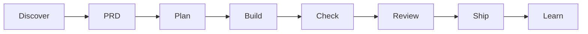

# System overview
<!-- cairn-system: 7534007 2026-11-17 -->
Generated by /cairn:system; do not edit by hand. Refresh with /cairn:system.

cairn is a Claude Code and Codex plugin that takes a feature from idea to shipped, recorded change in fixed steps. Engineers use it through slash commands. Agents do the work and the person approves the PRD, the plan and the ship. A small CLI owns each plan's state, markdown procedures tell agents what to do at each step, and a Claude Code mod adds the live pane and the approval checks. The repo is also its own marketplace and builds its own plans with cairn.

## Lifecycle
A plan moves through Discover, PRD, Plan, Build, Check, Review, Ship and Learn. Each stage has a procedure file, and `cairn next` prints the one that fits the plan's current stage and substep. Skills such as `/cairn:new` and `/cairn:next` are thin wrappers that call the CLI and follow that procedure. A depth level (MVP, Standard, Polished) chosen at the start sets how much review and testing each stage gets. A separate bug-fix lane handles one bug with a failing repro first.

Skeletons for the PRD, plan, record and config live in `plugins/cairn/templates/`.

**Start here:** `plugins/cairn/procedures/`, `plugins/cairn/skills/`, `plugins/cairn/references/levels.md`, `plugins/cairn/cli/src/commands/stages.ts`

## Trust layer
Plan state lives in a `state.json` that only the CLI writes. The CLI checks every move between stages and, when something is missing, refuses and prints the exact fix. Human approvals are proved by a one-time secret held by the mod, or by typing the plan name in a terminal with `--human`. Guards stop the model from running approve, setting the approver variable, or editing state. A ship approval covers one commit, and a merge check confirms nothing changed after it. A session works with one plan only. The guards stop accidents and habit, not a determined agent.

**Start here:** `plugins/cairn/cli/src/proof.ts`, `plugins/cairn/cli/src/state.ts`, `plugins/cairn/hooks/mod/guards.ts`, `plugins/cairn/hooks/NOTES.md`

## Plan location
The current git branch decides which plan a directory belongs to (`feature/<slug>`, `fix/<slug>`, task branches under `task/`). The CLI finds the plan's worktree and reads and writes state there, so several plans can run side by side. Plan folders are named by local date and slug. Older `sdlc` layouts are still read and `cairn migrate` moves them.

**Start here:** `plugins/cairn/cli/src/locate.ts`, `plugins/cairn/cli/src/paths.ts`, `plugins/cairn/cli/src/commands/migrate.ts`

## Build engine
The plan's task list is parsed into state with a cycle check, file scopes and requirement coverage. Ready tasks that do not overlap in files run in parallel, each in its own worktree with a fresh implementer agent, then merge back. Reviewers, a security reviewer and an acceptance checker sit behind each task and the branch, scaled by risk and level. Briefs and reports go to files on disk, so the main session routes work and carries little content. A task still stuck after two fixes is set aside.

**Start here:** `plugins/cairn/cli/src/plan-parse.ts`, `plugins/cairn/cli/src/ready.ts`, `plugins/cairn/cli/src/builder.ts`, `plugins/cairn/agents/`

## Proofs
When chosen at the start, each requirement becomes a runnable check, written before the build and seen failing first. The plan approval locks them. Builders may add proofs but never edit or remove one, and a merge that touches a locked proof file is refused. All proofs must be green to leave Check and to approve the ship. UI proofs save screenshots that a fresh agent judges against the agreed look. A user-approved retire handles a wrong locked proof.

**Start here:** `plugins/cairn/cli/src/endproofs.ts`, `plugins/cairn/cli/src/commands/prove.ts`, `plugins/cairn/agents/proof-writer.md`

## Fresh-eyes review
Fresh agents that have not seen the author's reasoning challenge the work at each point. A challenger raises other approaches during discovery, checkers read the PRD and the plan cold, and a reviewer reads the whole branch before ship. Findings carry labels, and Critical or Required ones block with a named fix. The repo's `REVIEW.md` supplies project-specific rules, and the review and security checklists live in references.

**Start here:** `plugins/cairn/agents/branch-reviewer.md`, `plugins/cairn/references/review-checklist.md`, `REVIEW.md`

## Live pane and cost
The mod shows a pane beside the chat with a card per running agent, the plan's stage and level, a status bar, and tabs for Now, History, Records, Changelog and Linear. It also adds instant commands for approving, changing level, pausing and resuming. A usage ledger records cost and tokens per plan, shown in the pane, in status output and in the close record. Cost is shown but not capped.

**Start here:** `plugins/cairn/hooks/register.tsx`, `plugins/cairn/hooks/mod/pane.tsx`, `plugins/cairn/hooks/mod/ledger.ts`, `plugins/cairn/cli/src/usage.ts`

## Pause and resume
Pause lets running work reach a safe point and writes a handoff note. Stop-now ends the turn and records where each task stood. Resume gives a short recap and continues with only the unfinished steps, even in a new session. A heartbeat tracks live sessions so approvals and bindings stay fresh.

**Start here:** `plugins/cairn/cli/src/commands/pause.ts`, `plugins/cairn/hooks/mod/pause.ts`, `plugins/cairn/hooks/mod/heartbeat.ts`

## Memory
cairn keeps what was done, not how code works now, so nothing it stores goes stale. Each plan keeps a record and a short changelog entry, and `docs/cairn/OVERVIEW.md` is the generated changelog. Follow-up suggestions from every plan are collected and can become a fix or be dismissed. This file is the separate whole-system view, stamped with the commit it was built from and refreshed on request only.

**Start here:** `plugins/cairn/cli/src/memory.ts`, `plugins/cairn/cli/src/commands/records.ts`, `plugins/cairn/cli/src/commands/suggest.ts`, `plugins/cairn/cli/src/commands/system.ts`

## Linear
Plans can start from Linear issues, epics, milestones or projects. Specced tickets carry what cairn needs to build them. The CLI queues status updates and a background sender delivers them through the Linear tools. A board view shows each project's work across plans as done, in a plan, ready or blocked. Task-to-ticket links, parallelism and per-ticket status follow the plan through merge.

**Start here:** `plugins/cairn/cli/src/linear.ts`, `plugins/cairn/cli/src/board.ts`, `plugins/cairn/cli/src/spec.ts`, `plugins/cairn/references/linear-tickets.md`

## Hosts and distribution
cairn runs in Claude Code with the full mod and in Codex without one, where a pre-tool hook applies the same pure guard rules. The CLI is a zero-dependency TypeScript bundle, committed as `dist/cairn.mjs`, launched from `cli/bin`. People install from GitHub and get a cached copy keyed by the version in both plugin manifests, so a release must raise both.

**Start here:** `plugins/cairn/references/hosts.md`, `plugins/cairn/hooks/mod/guard-rules.ts`, `plugins/cairn/.claude-plugin/plugin.json`, `plugins/cairn/.codex-plugin/plugin.json`
