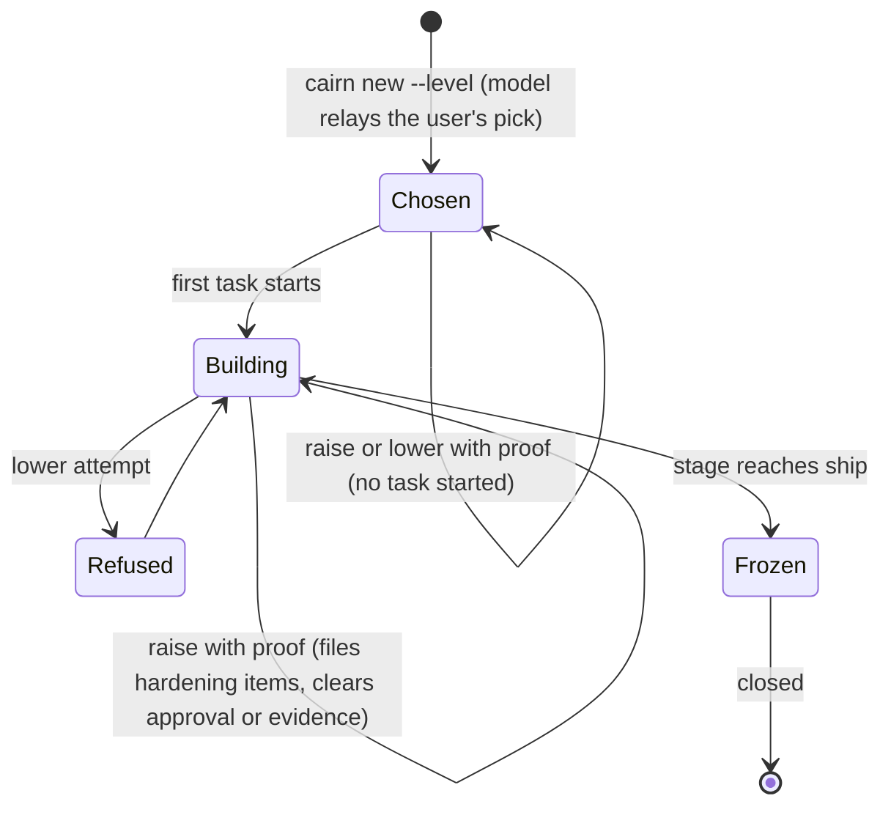
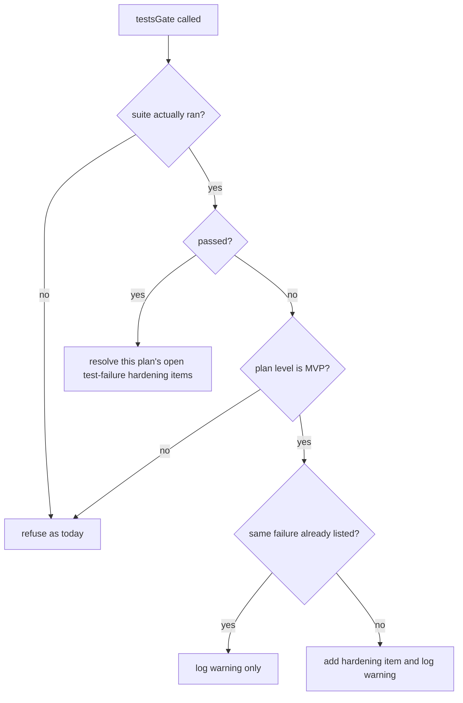

# Cairn Depth Levels and Workflow Gaps - Plan

## Goal Capsule

- **Objective:** At the start of every cairn feature plan, the user chooses how much effort the whole build spends, from a fast MVP to a polished build. The run's time follows that choice, and the security floors and the three approvals stay in place.
- **Means:** one level stored on the plan, read by every stage, enforced by the CLI where a gate exists and by procedure text everywhere else (Key Decisions; KTD1, KTD8).
- **Product authority:** the repo owner. The Product Contract below is theirs; the Planning Contract is the how.
- **Execution profile:** TypeScript CLI changes in `plugins/cairn/cli/src/` (rebuild and commit `plugins/cairn/dist/cairn.mjs`), mod changes in `plugins/cairn/hooks/mod/`, markdown in `plugins/cairn/procedures/`, `references/`, `agents/`, `skills/`, and `README.md`.
- **Stop conditions:** stop and ask if a change would add a human approval stop beyond R20's re-approval, weaken a floor in R9-R11, or bump `state.json`'s `schema`.
- **Who finishes:** Compound Engineering builds it on a feature branch and opens a PR; the repo owner merges and runs the live pane checks in the Verification Contract.
- **Open blockers:** none.

---

## Product Contract

**Product Contract preservation:** changed: R5 (no level change while paused), R7 (lowering is keyed on whether any task has started, not the current stage, so re-plan cannot reopen it), R8 (limited to changes after creation, per the user's choice below), R10 (whole-branch security review at every level, unconditionally), R18 (wall-clock only; tokens deferred). Added R19 and R20 from the plan-time scoping the user confirmed; R20 applies only before any task starts. All changes were the user's choices during planning and review. Gap findings and recommendations unchanged.

### Summary

Cairn gains a depth level, either MVP, Standard or Polished, that is chosen when each feature plan starts and read by every stage after that. MVP cuts the interview, plan, review and testing down to a floor that keeps security checks and approvals. Standard is cairn as it works today. Polished adds the deeper checks that cairn is missing. A ranked list of the remaining gaps against Compound Engineering 3.30.1 and superpowers 7.0.0 follows the requirements.

### Problem Frame

A cairn feature run often takes an hour or more from `/cairn:new` to an open PR, and every run pays roughly the same price. Most early work, whether greenfield builds or feature revisions, is MVP work, where the goal is to find out whether something is worth building. Full interviews, a reviewer on every task, opus branch review and thorough acceptance checks are premature at that point. They spend time and tokens on code that may be thrown away next week.

Today the only way to make a run lighter is to skip cairn. Inside cairn, rigor is fixed for each stage. The only knobs are a per-task `risky` flag, a per-task `complexity` that picks the implementer's model, and the split between the feature and fix tracks. None of these say anything about where the product is in its life.

The other two workflows don't solve this. Compound Engineering sizes each stage separately from the task in front of it, and nothing the user picks at the start carries through the build. superpowers has the agent name a size for the brainstorm and lets the user choose the executor, but test-first is required nearly everywhere and there is no light mode. Neither treats "we are building an MVP" as an input.

### Key Decisions

- **The level describes the product's stage, not the task's risk.** The user steers by where the product is (prototype or polished). Risk handling stays separate and works as a floor (see the next decision). Governs R1, R9-R11.
- **One level on the plan, and every stage reads it.** Chosen over a separate track per level (raising the level mid-run would mean jumping between stage sequences, and every procedure would exist three times) and over a time or token budget (cairn can't predict effort well enough to make a budget repeatable). Governs R1, R5, R13, R16, R17.
- **The level sets the ceiling and risk sets the floor.** The floor is taken from Compound Engineering's code review, which can only move toward a fuller review. At any level, trust-boundary work still gets security review, and nothing else is pulled up automatically. Governs R9-R11.
- **Three levels.** Today's behavior keeps a name (Standard), so nothing changes for anyone who doesn't choose a level. Chosen over two levels (no room for a deeper level) and four (a throwaway "spike" overlaps the fix track and prototype tools). Governs R1, R16, R17.
- **The level can go up at any time and down only before any task starts.** A Polished plan can't quietly drop its reviews halfway through. Governs R5-R8, R20.
- **The level picked at `/cairn:new` is applied by the model; later changes need the user's proof.** (session-settled: user-directed — chosen over a pane-proven first pick: no extra friction, and a misrelayed level shows in the pane before anything runs.) Governs R2, R8.
- **In MVP, tests warn and don't block.** The suite still runs, so breakage is visible, but it never stops the run. Governs R12, R19.
- **MVP shortcuts become a hardening list, not ordinary follow-ups.** The list sits outside the 5-follow-up cap, and a later deeper plan on the same area offers it as scope, so moving past the MVP is one deliberate run. Governs R14, R15.
- **The level picker is a question, not an approval stop.** An earlier plan set "depth must not add stops" as a non-goal (`docs/sdlc/plans/2026-10-21-sharper-interview-and-review/prd.md:76`). The picker is one question inside `/cairn:new`, and Polished's extra checks are agent passes, not human gates. R20's re-approval reuses the existing plan approval. Governs R2, R17, R20.

### Requirements

**Choosing the level**

- R1. Every feature plan has exactly one level: MVP, Standard or Polished.
- R2. `/cairn:new` asks for the level on every new feature plan, with the repo's default pre-selected. The repo default is a config value, and it is Standard when unset.
- R3. The fix track has no level and keeps its current flow.
- R4. The level appears in `cairn status`, in the pane, and in the plan's record.

**Changing the level**

- R5. The user can raise the level at any stage before ship while the plan isn't paused. Every stage after the change runs at the new level.
- R6. When the level is raised after build has started, cairn offers a hardening pass that brings already-merged work up to the new level, for example the per-task reviews and tests that MVP skipped.
- R7. The level can be lowered only while no task has started.
- R8. After creation, only the user changes the level: from the pane, from a level menu the agent shows, or with `--human` in a terminal. The model may suggest raising it but never changes it itself.
- R20. Raising the level after the plan was approved but before any task starts clears that approval, so the user approves the plan once more. A raise during build adds no stop: the new level applies to the remaining tasks and merged work goes through R6. Raising after Check or review recorded a result makes that stage run again at the new level.

**Floors that hold at every level**

- R9. Check runs the secret scan and the dependency audit.
- R10. Any task that touches a trust boundary gets a security review, using the same signals that trigger per-task security review today (auth, money, deletes, migrations, public API, untrusted input, personal data, new dependencies, model output, shell or paths built from data). The plan still flags such tasks as risky at every level. The whole-branch security review runs at every level, unconditionally.
- R11. The PRD, plan and ship approvals stay as they are.

**What each level does**

- R12. In MVP, cairn runs the test suite at every point it runs tests today (task merge, phase end, Check, close). A failure from a suite that actually ran is added to the hardening list and doesn't block; a suite that could not run still blocks as today.
- R19. An MVP plan may close and open its PR with tests failing; the record and the ship approval list the known failures.
- R13. Each stage scales to the level as shown in the table below.
- R14. When an MVP plan closes, cairn writes a hardening list of untested areas, skipped reviews, failing tests and deferred review findings. That list doesn't count toward the 5-open-follow-up limit on close.
- R15. When a Standard or Polished plan starts on an area that overlaps an MVP plan's hardening list, discover offers those items as scope, the same way it offers matching follow-ups today.
- R16. Standard behaves as cairn does today.
- R17. Polished adds the items in the table below. An item that needs a capability cairn doesn't have yet takes effect when that capability lands. Until then, Polished runs Standard plus the items that already exist.

| Stage | MVP | Standard (today) | Polished |
|---|---|---|---|
| Discover | A short interview: goal, the one flow that must work, trust boundaries. No implications multi-select. | Current interview | Current interview, plus a builder check (a fresh agent reads the PRD as the person who has to build it) and two or three approaches compared before the PRD |
| PRD | Thin: Problem, Solution, Requirements with one-line checks, Non-goals. Security section only when a trust boundary was recorded. | Current PRD | Adds acceptance examples for conditional requirements |
| Plan | Few, large vertical tasks, usually one phase. No test cases listed. | Current plan | Test cases for every task, the failure modes each test pins, and a fresh-agent review of the plan before approval |
| Build | No per-task review except the floor's security review. Implementer models lean one tier lower. Tests warn (R12). | Every task reviewed; security review for risky work | Test-first for every task; automatic on-track check at each phase end |
| Check | Floor scans; tests warn | Tests, build, scans, acceptance checker | Adds app or browser verification, and every requirement must be met and tested |
| Review | One light whole-branch review on a mid-tier model, plus the whole-branch security review | Opus branch review plus security review | Adds a simplify pass and a roster of focused reviewers |
| Ship and Learn | Short record plus the hardening list; no learn step | Current ship and learn | Adds a captured learning that later plans read |

**Measuring what each level costs**

- R18. Each plan records the elapsed wall-clock time in each stage, excluding paused time. The figures show in `cairn status`, in the pane and in the record, so the levels can be compared.

### Acceptance Examples

- AE1. **Covers R12.** **Given** an MVP plan, **when** a task merges and the suite runs and fails, **then** `cairn task done` succeeds, one hardening item records the failing command and the task's scope, and the same failure at phase end adds no second item.
- AE2. **Covers R10.** **Given** an MVP plan, **when** a task's diff touches auth, **then** the procedure dispatches the security reviewer on that task, and a Critical finding goes through the fix loop before merge as it does today.
- AE3. **Covers R5, R6.** **Given** an MVP plan in its second phase of build, **when** the user raises it to Standard from the pane, **then** the remaining tasks get per-task review, and each already-merged task that skipped review gets a hardening item that the execute procedure offers to work through.
- AE4. **Covers R7.** **Given** a Polished plan where a task has started (even after a re-plan moved the stage back to plan), **when** the user tries to lower it, **then** cairn refuses and explains that lowering is only allowed before any task starts.
- AE5. **Covers R14, R15.** **Given** a closed MVP plan whose hardening list names the API routes, **when** a Standard plan starts on those routes, **then** discover offers the hardening items as scope.
- AE6. **Covers R14.** **Given** an MVP plan with nine hardening items and two ordinary follow-ups, **when** it closes, **then** close is allowed, and `cairn status` counts two open follow-ups plus nine hardening items.
- AE7. **Covers R20.** **Given** an approved MVP plan still at the plan stage, **when** the user raises it to Polished, **then** the plan approval is cleared and the plan procedure adds test cases before asking for approval again.
- AE8. **Covers R19.** **Given** an MVP plan whose suite fails at close, **when** ship asks for approval, **then** the approval question and the record both name the failing command.

### Success Criteria

- An MVP feature run takes visibly less time than the same feature at Standard, as R18's figures show. There's no target number yet; it gets set once a few real runs have a baseline.
- Before a run starts, the user can predict what each level will and won't do, from the table alone.
- No MVP run skips a floor in R9-R11.

### Findings: how cairn compares

Cairn's core design is ahead of both. Its CLI is the only writer of plan state, it refuses a move with the exact fix, approvals need proof that a human gave them, and guards stop the model from approving its own work. superpowers enforces everything through prompts; its only hook injects context at session start. Compound Engineering has no stage machine and keeps no lifecycle state in its plans. Keep these.

| Capability | cairn | Compound Engineering | superpowers |
|---|---|---|---|
| User-chosen depth | None | Auto-sized per stage, not carried forward; "go deep" only in ideation | Agent names a size for the brainstorm; user picks the executor |
| Enforced stage gates | CLI refusals, human-proof approvals | Prompt-level, structured statuses between skills | Prompt-level only |
| Parallel build | Parallel tasks with non-overlapping file scopes, capped | Parallel batches with a safety check | Never parallel implementers |
| Interview / brainstorm | One question at a time, confidence read-back, trust boundaries required | Sized tiers, pressure test, approach comparison, claim verifier | Sized, playback, builder check, spike mode |
| Plan review | None (user only) | Document review with role lenses; "deepen" pass | Self-review and a builder check |
| Test discipline | Test-first only for risky tasks | Proof-first default, recorded evidence per unit | Test-first required, verification-before-completion |
| Per-task review | Every task, one fix plus one re-review | Not per task; reviews the whole diff | Every task (subagent mode), up to 5 fix rounds |
| Branch review | Opus branch reviewer plus security, five-axis checklist | Lite/focused/full by risk, ~15 reviewer personas, cross-model peer | One final review on the most capable model |
| App verification | None (`start`, `seed`, `appTypes` unused) | Browser, iOS simulator, dogfood QA | None |
| Debugging | Fix track with a failing repro | Diagnosis loop with a causal-chain gate | Four-phase systematic debugging; stop after 3 failed fixes |
| After the PR | Merge prompt | Watches the PR, resolves review comments, fixes CI | Merge / PR / keep menu |
| Learnings | Record per plan; learn stage is a v0.1 stub | Solutions store with a strict bar, refresh audit, read by plan and review | None |
| Resume and status | Pause/resume handoff, pane, status | Handoff skill | Per-plan progress file |

### Recommendations: other gaps, ranked

Ranked by how much each serves the goal above. Each one names the level it mainly serves. Items 1-3 are built by this plan (R18, U6, U11); the rest are later plans.

1. **Measure each stage first (all levels).** R18 is cheap because the state log already timestamps every event (`plugins/cairn/cli/src/state.ts:36-38`). Without a baseline, there's no way to tell whether MVP worked. A follow-on is a post-mortem command, modeled on superpowers' `diagnosing-superpowers`, that reads a slow run's log and names where the time went.
2. **Guard branch discipline before MVP lowers model tiers (all levels).** Haiku implementers have committed onto the plan branch instead of their task branch (`docs/sdlc/plans/2026-10-21-sharper-interview-and-review/RECORD.md:23`). MVP pushes more work to cheaper models, which makes this more likely. Have the CLI detect and refuse it.
3. **Fix the docs that disagree with the procedures (all levels).** The README says only risky tasks get a reviewer (`README.md:27`, `README.md:105`), but every task is reviewed (`plugins/cairn/procedures/execute.md:50`). The README and the fix skill say fixes are reviewed only when risky (`README.md:180`, `plugins/cairn/skills/fix/SKILL.md:3`), but every fix is (`plugins/cairn/procedures/fix.md:51`). The README says Learn asks one optional question (`README.md:109`), but it asks nothing (`plugins/cairn/procedures/learn.md:3`).
4. **Make learnings compound (Standard, Polished).** Learn is a stub (`plugins/cairn/procedures/learn.md:5`), and nothing reads past records' Findings into new plans. Adopt Compound Engineering's approach: capture one learning only when it isn't recoverable from the code, store it where discover and plan search it, and periodically check stored learnings against the current code.
5. **Add app-level verification (Polished).** Check never runs the app. The `start`, `seed` and `appTypes` config is recorded but unused (`README.md:208`). Use it to drive a browser or simulator check against the PRD's flows. The repo owner's `sim-test` skill and Compound Engineering's `ce-test-browser` show the shape.
6. **Size branch review by risk within a level (Standard, Polished).** Borrow Compound Engineering's test: would a wrong version of this change fail loudly where it's made, or silently somewhere else? Silent failures and trust boundaries get the full review. Polished adds focused reviewers (testing, performance, API contract, data migration) and a simplify pass, which cairn's design already planned for v0.3 (`docs/design.md:195`).
7. **Review the plan before approval (Polished).** No agent reviews the PRD or plan today; the user is the only reviewer (`plugins/cairn/procedures/prd.md:3`). A fresh agent that reads the plan as the builder and lists what it would have to guess catches gaps cheaply. This plan builds the plan-review half (U9); the PRD builder check is later.
8. **Record verification results, not claims (all levels).** Check and review evidence is a free-text note the agent writes (`plugins/cairn/references/cli.md:118`). Where the CLI already runs the tests itself, it can record the actual result.
9. **Give blocked tasks a debugging path (Standard, Polished).** Add a short diagnosis step before restarting a blocked task a tier up, and question the design after three failed fixes, as superpowers and `ce-debug` both do.
10. **Follow the PR through (Standard, Polished).** Ship ends at the merge prompt. Watching CI and resolving review comments on the open PR, as `ce-babysit-pr` and `ce-resolve-pr-feedback` do, would close the loop.
11. **Test cairn's own procedures by behavior (maintainer).** Cairn's tests check procedure wording. superpowers tests a skill by running an agent without it, then with it, and closing the loopholes it finds. The `claude plugin eval` command could run such checks for the level table.

What not to copy:
- Compound Engineering's per-stage reclassification works against steering the run from the start.
- superpowers' test-first-everywhere rule contradicts MVP.
- A hands-off run to a PR with no stops (as in `lfg`) conflicts with the approval floor.
- superpowers' ban on parallel implementers would throw away one of cairn's strengths.
- Cross-model review peers could become a Polished option later, but they cost too much to be a default.

### Scope Boundaries

- The fix track gets no level (R3).
- No new approval stops at any level; R20 reuses the existing plan approval.
- Polished in this plan: test cases and test-first on every task, the automatic on-track check, met-and-tested acceptance, and the plan review (U9). Its other table items arrive with their own plans (R17).
- Token counts are not recorded (R18); they live only in the mod's memory today.

#### Deferred to Follow-Up Work

- PRD builder check and approach comparison in Polished discover.
- Simplify pass and focused reviewer roster in Polished review.
- App or browser verification in Polished Check.
- Captured learnings read by later plans.
- Persisting per-plan token use from the mod so R18 can show it.
- Recommendations 4-11 above.

#### Considered and not built

- A minimum-version refusal for an older installed cairn reading a plan with a level. An older binary ignores the level and treats the plan as Standard, which errs toward more rigor; a `cairnVersion` stamp on the state makes the mismatch visible instead (KTD11). Evidence that would change this: an older binary closing a plan and dropping its hardening list in practice.
- A tagged menu for the first level pick. The user chose model relay at creation (Key Decisions).

### Sources

- Cairn: `plugins/cairn/references/cli.md` (gates at :73 and :116), `plugins/cairn/procedures/execute.md:50-52`, `plugins/cairn/procedures/review.md:13`, `plugins/cairn/procedures/phase-end.md:23`, `plugins/cairn/procedures/learn.md:3-5`, `plugins/cairn/procedures/plan.md:29`, `plugins/cairn/agents/implementer.md:13-14`, `plugins/cairn/references/model-tiers.md:9-11`, `plugins/cairn/cli/src/commands/suggest.ts:18`.
- Compound Engineering 3.30.1: `ce-brainstorm/references/phase-0.md` (scope tiers), `ce-plan/references/intake.md:132` (plan depth classified inside `ce-plan`), `ce-code-review/references/modes-and-output.md:64-72` (lite/focused/full; "a path may only move toward full"), `ce-compound/SKILL.md` (learning bar).
- superpowers 7.0.0: `brainstorming/SKILL.md:129-140` (size the work), `subagent-driven-development/SKILL.md:193-194` and `:373` (final review model, 5-round fix cap), `test-driven-development/SKILL.md:18-27`, `verification-before-completion/SKILL.md:17`.

---

## Planning Contract

### Key Technical Decisions

- KTD1. **`level` is an optional field on the plan state, read through one helper.** No `schema` bump: `loadState` rejects any schema other than 1 (`plugins/cairn/cli/src/state.ts:22`), and older readers (the mod, `suggest.ts`, `records.ts`) parse states without the field. The helper returns Standard for old plans and the fix track. The pane shows no level for a plan without the field, rather than claiming a choice nobody made. Governs R1, R3, R4.
- KTD2. **Each task records the level in force when it started.** The hardening pass on a raise (R6) needs to know which merged tasks ran at a lower level; nothing in `Task` records that today. Review and test-first rules for an in-flight task follow the plan's current level at the moment the procedure reaches that step.
- KTD3. **The hardening list is a kind of follow-up, not a separate store.** A `kind: 'hardening'` on `Suggestion` with a new `from` value for MVP keeps cross-plan collection, discover's `--for` matching, resolve, merge and records working. It changes four existing rules together: the close cap, the open count in status and pane, the 60-day and two-decline expiry, and a required non-empty `where` (task scope, or the union of the plan's task scopes for a whole-suite failure). Alternative rejected: a new area, because an area is a topic, not a lifecycle. Governs R14, R15.
- KTD4. **MVP test warnings live in `testsGate`, keyed on a suite that actually ran.** All three CLI test gates (`task done`, `phase finish`, `close`) already pass through `testsGate` with the plan state (`plugins/cairn/cli/src/shared.ts:118`). Check runs its suite through the agent today, not the CLI, so a new `cairn test` command runs the configured suite through the same `testsGate`; the verify and ship procedures use it. A synthetic "not run" failure (dirty or unmerged worktree) still refuses. At most one open test-failure hardening item exists per plan per test command: a repeat failure only logs, and a green run resolves it. The item stores the command and the run's summary line, never raw test output, because `runTests` keeps only a summary and raw output can carry secrets into committed state. Governs R12, R19.
- KTD5. **`cairn level` requires human proof for every change, raise or lower.** It reuses `requireHumanProof` with refusal text that no longer hard-codes `approve`. The mod gets a `/cairn-level` command and a `[cairn:level <slug>]` tag on the agent's level menu; the mod maps the chosen option label to one of the three literals and never trusts model text, and it applies the same answer checks as approvals (ignore prefilled, AFK-auto-answered and multi-select answers). The mod reuses the existing secret-run helper in `approve.ts`, which already serializes secret use. Without the mod, the procedure prints `cairn level <lvl> --human` for the user. A same-level request succeeds without spending proof. Governs R8.
- KTD6. **Lowering is refused once any task has a start time.** Keying on the stage would let re-plan or escalate reopen lowering after code merged. Level changes are also refused while paused and at ship, learn or closed. Governs R5, R7.
- KTD7. **Raising has three side effects, all written by the CLI.** Raising with an approved plan before any task starts clears that approval (R20); a raise during build leaves the approval alone. Raising after Check or review recorded evidence deletes that evidence, the same way re-plan clears state today (`plugins/cairn/cli/src/commands/planload.ts:26`); a raise at review that clears Check evidence also moves the stage back to verify through `setStage`, because the review-to-ship gate checks only review evidence and Check would otherwise never run again. Raising after any task finished files one hardening item per finished task that ran below the new level, so the offer survives a pause or a lost session. Governs R6, R20.
- KTD8. **Every stage change goes through one `setStage` helper that appends to a stage history.** Stage is assigned in seven places today (`planload.ts:26`, `fix.ts:124`, `plans.ts:36`, `stages.ts:204` and `:225`, `phase.ts:56`, `tasks.ts:66`), and three of them log no `advanced` entry. Durations sum every visit to a stage, subtract paused intervals, freeze a paused current stage at its pause time, and report "n/a" for plans with no history. The CLI computes them and returns them in `status --json`; the pane and recorder only display them. A test fails if any command assigns `stage` outside the helper. Governs R18.
- KTD9. **Per-level behavior is written into the existing procedures, with one shared table in `plugins/cairn/references/levels.md`.** Procedures already read the plan state through `cairn status --json` (`plugins/cairn/cli/src/commands/status.ts:73-76`), so no templating or variant files are needed. The table owns R13's rules; each procedure carries a short "At this level" block that cites it. Existing headings, numbering and the phrases the doc tests pin stay as they are. Floor text in `verify.md` stays unconditional and verbatim.
- KTD10. **MVP review dispatches the existing branch reviewer with a sonnet model override.** `agents/branch-reviewer.md` keeps `model: opus`, which a doc test pins; the procedure passes the lower tier at dispatch. The MVP model-tier rows live in a separate table in `model-tiers.md` so the pinned rows don't change.
- KTD11. **The record keeps its six sections and the CLI's 600-word cap at every level; MVP's shortness is a recorder target.** The recorder aims for about 300 words at MVP. A per-level CLI cap would add a new blocking gate to MVP and force three record-check paths to change together, for no harm prevented. The recorder states the level, gives the hardening count grouped by area, names known failing test commands under Follow-ups, and adds a one-line time-per-stage summary under Findings. Every new state is stamped with the `cairnVersion` that created it.
- KTD12. **The CLI words the level for display.** `status --json` returns a short level label next to the existing step text, the same way `stepText` already works, so the pane never rewords it. The label rides on the existing header line to stay inside the 7-row inline budget (`plugins/cairn/hooks/mod/pane.tsx:36`).
- KTD13. **`task done` refuses when the plan branch gained commits inside the task's scope that did not come from a task merge.** This catches the implementer-on-the-plan-branch failure recorded twice. Cairn's own state commits under `docs/sdlc/` are ignored. The exact detection is an implementation-time detail (see Open Questions).

### High-Level Technical Design

Level lifecycle on a plan (CLI-enforced; procedures read the result):

MVP test gate (one function for all three call sites):

### Sequencing

CLI state and gates first (U1-U6), then the record (U10), then the mod (U7), then the new agent and procedures (U9, U8), then the README (U11). Rebuild the bundle after every CLI unit so the procedures and mod run against matching code.

---

## Implementation Units

### U1. Level on the plan

**Goal:** Store, default, validate and expose a plan's level.
**Requirements:** R1, R2, R3, R4; KTD1, KTD2, KTD11 (version stamp), KTD12.
**Dependencies:** none.
**Files:** `plugins/cairn/cli/src/types.ts`, `plugins/cairn/cli/src/state.ts`, `plugins/cairn/cli/src/config.ts`, `plugins/cairn/cli/src/commands/plans.ts`, `plugins/cairn/cli/src/commands/fix.ts`, `plugins/cairn/cli/src/commands/tasks.ts`, `plugins/cairn/cli/src/commands/status.ts`, `plugins/cairn/cli/src/render.ts`, `plugins/cairn/templates/config.json`, `plugins/cairn/cli/test/levels.test.ts` (new).
**Approach:**
1. Add a `Level` type, optional `level` and `cairnVersion` on `State`, optional `level` on `Task`, optional `defaultLevel` on `Config`, and a `levelOf` helper.
2. `cairn new` takes `--level`; a bad flag value refuses, a bad `defaultLevel` warns and falls back to Standard. Fix-track plans get no level; escalate leaves the level unset so it reads as Standard.
3. `task start` stamps the task with the plan's current level.
4. `status --json` and `next --json` include the level and a short level label.
**Patterns to follow:** optional-field-by-absence reads such as `s.suggestions ?? []` in `plugins/cairn/cli/src/commands/suggest.ts`; `stepText` in `status.ts`; lifecycle test helpers in `plugins/cairn/cli/test/lifecycle.test.ts`.
**Test scenarios:**
- `cairn new` with `--level mvp` stores mvp and logs it.
- `cairn new` with no flag uses `defaultLevel` from config, and Standard when config has none.
- `cairn new --level fast` refuses and names the three values.
- An invalid `defaultLevel` warns and creates a Standard plan.
- A fix-track plan has no level, and `levelOf` returns Standard.
- A state file without `level` loads and reports Standard; the pane label is empty.
- `task start` on an MVP plan stamps the task with mvp.
- `status --json` includes the level and its label.
**Verification:** a new plan carries the chosen level in `state.json` and `cairn status`.

### U2. Stage history and elapsed time

**Goal:** Record every stage entry and report elapsed wall-clock time per stage.
**Requirements:** R18; KTD8.
**Dependencies:** U1.
**Files:** `plugins/cairn/cli/src/state.ts`, `plugins/cairn/cli/src/commands/planload.ts`, `plugins/cairn/cli/src/commands/fix.ts`, `plugins/cairn/cli/src/commands/plans.ts`, `plugins/cairn/cli/src/commands/stages.ts`, `plugins/cairn/cli/src/commands/phase.ts`, `plugins/cairn/cli/src/commands/tasks.ts`, `plugins/cairn/cli/src/commands/status.ts`, `plugins/cairn/cli/test/timing.test.ts` (new).
**Approach:**
1. Add `setStage`, which sets the stage and appends `{stage, at}` to an optional stage history.
2. Replace all seven direct assignments with it.
3. Compute per-stage elapsed time from the history and the `paused`/`resumed` log entries, and return it in `status --json`.
**Patterns to follow:** `log()` in `plugins/cairn/cli/src/state.ts`; pause entries in `plugins/cairn/cli/src/commands/pause.ts`.
**Test scenarios:**
- Advancing discover to prd records two history entries, and the discover time equals the gap between them.
- A paused interval is excluded from the stage's time.
- A plan paused now reports its current stage frozen at the pause time.
- Re-plan back to plan, then plan to execute again, sums both plan visits.
- A plan with no history reports n/a, not zero.
- A source scan finds no `.stage =` assignment in `cli/src/commands/` outside `setStage`.
**Verification:** `cairn status --json` shows per-stage durations for a plan driven through several stages.

### U3. Hardening items

**Goal:** Add the hardening kind of follow-up with its exemptions.
**Requirements:** R14, R15; KTD3. Covers AE5, AE6.
**Dependencies:** U1.
**Files:** `plugins/cairn/cli/src/types.ts`, `plugins/cairn/cli/src/commands/suggest.ts`, `plugins/cairn/cli/src/commands/stages.ts`, `plugins/cairn/cli/src/commands/records.ts`, `plugins/cairn/cli/src/commands/status.ts`, `plugins/cairn/cli/test/followups.test.ts`, `plugins/cairn/cli/test/hardening.test.ts` (new).
**Approach:**
1. Add optional `kind` and an MVP `from` value.
2. `suggest add --kind hardening` requires a non-empty `--where`.
3. Exclude hardening items from the close cap and from the open count, and report them as a separate count.
4. Skip the 60-day and two-decline expiry for them.
5. Keep them in `suggest list --for` matching and in records.
6. When an MVP plan advances to ship, file one hardening item per finished task that ran at MVP without being flagged risky (its per-task review was skipped), scoped to that task. Deferred review findings and the plan's untested areas at MVP are filed by the procedures with `--kind hardening` (U8).
**Patterns to follow:** `collectSuggestions` and `MAX_OPEN_PER_PLAN` in `plugins/cairn/cli/src/commands/suggest.ts`; close cap in `closeGates` (`plugins/cairn/cli/src/commands/stages.ts`).
**Test scenarios:**
- Covers AE6. An MVP plan with nine hardening items and two follow-ups closes; status shows 2 open and 9 hardening.
- Six ordinary follow-ups still refuse close.
- A hardening item declined twice and 61 days old is still open.
- `suggest add --kind hardening` without `--where` refuses.
- Covers AE5. `suggest list --open --for 'src/api/**'` from another plan returns a closed MVP plan's hardening item on `src/api/routes.ts`.
- `cairn records` lists hardening items for the plan.
- An MVP plan with three finished tasks, one risky, gains two skipped-review hardening items when it advances to ship.
**Verification:** hardening items behave as follow-ups everywhere except the cap, count and expiry.

### U4. MVP test warnings

**Goal:** Make red suites warn at MVP without weakening the "not run" refusal.
**Requirements:** R12, R19; KTD4. Covers AE1.
**Dependencies:** U1, U3.
**Files:** `plugins/cairn/cli/src/shared.ts`, `plugins/cairn/cli/src/types.ts`, `plugins/cairn/cli/src/main.ts`, `plugins/cairn/cli/src/commands/tasks.ts`, `plugins/cairn/cli/src/commands/phase.ts`, `plugins/cairn/cli/src/commands/stages.ts`, `plugins/cairn/cli/test/mvp-tests.test.ts` (new).
**Approach:**
1. Mark whether a test run actually executed.
2. In `testsGate`, at MVP and only for a run that executed and failed, log a warning, open or refresh the plan's single test-failure hardening item for that command (text: command and summary line; `where`: the task's scope, or the union of the plan's task scopes outside a task), and let the caller continue.
3. A green run resolves this plan's open test-failure item for that command.
4. Add `cairn test`, which runs the configured suite in the plan worktree through `testsGate` with the event `check` and reports the result. At Standard and Polished it reports red without refusing anything, since Check's own fix loop handles it.
5. Open test-failure items are what the ship approval and the record name as known failures (R19). A suite that first goes red at `close` after approval is logged as a warning and listed in `status --json`.
**Patterns to follow:** the existing warning path for a missing test command in `testsGate`.
**Test scenarios:**
- Covers AE1. MVP `task done` with a failing suite succeeds and opens one hardening item with the task's scope.
- The same failing command at `phase finish` adds no second item and logs a warning.
- A dirty task worktree still refuses at MVP.
- Standard `task done` with a failing suite still refuses.
- A later green `task done` resolves the open test-failure item.
- MVP `cairn test` with a red suite opens the item and exits successfully; at Standard it reports red and changes nothing.
- The hardening item text holds the command and the summary line only.
- MVP `close` with a red suite closes and the failure appears in `status --json`.
**Verification:** an MVP plan reaches close with a failing suite, and a Standard plan cannot.

### U5. Changing the level

**Goal:** A human-proven `cairn level` command with the raise and lower rules.
**Requirements:** R5, R6, R7, R8, R20; KTD5, KTD6, KTD7. Covers AE3, AE4, AE7.
**Dependencies:** U1, U3.
**Files:** `plugins/cairn/cli/src/shared.ts`, `plugins/cairn/cli/src/main.ts`, `plugins/cairn/cli/src/commands.ts`, `plugins/cairn/cli/src/commands/level.ts` (new), `plugins/cairn/cli/test/level.test.ts` (new), `plugins/cairn/cli/test/proof.test.ts`.
**Approach:**
1. Generalize `requireHumanProof`'s refusal text so it names the action it guards.
2. `cairn level <mvp|standard|polished>` succeeds without proof when the level is unchanged. Otherwise it requires proof and refuses on the fix track, while paused, at ship, learn or closed, and for any lower once a task has started.
3. A raise clears the plan approval at the plan stage, deletes recorded Check or review evidence (moving a review-stage plan back to verify when Check evidence is cleared), and files hardening items for finished tasks stamped below the new level.
**Patterns to follow:** `mutate` and `gate` in `plugins/cairn/cli/src/shared.ts`; approvals in `plugins/cairn/cli/src/commands/stages.ts`; `asUser()` in `plugins/cairn/cli/test/lifecycle.test.ts`.
**Test scenarios:**
- `cairn level polished` without proof refuses and says how to run it with `--human` or the pane.
- With proof, raising MVP to Standard during discover succeeds and logs the change.
- Covers AE4. Lowering after a task started refuses, including after a re-plan moved the stage back to plan.
- Lowering during prd with no task started succeeds.
- Covers AE7. Raising an approved plan at the plan stage clears `approvals.plan`.
- Raising during execute after a task started leaves `approvals.plan` in place.
- Raising during review clears Check and review evidence and moves the stage back to verify.
- Raising during verify clears the recorded Check result and stays at verify.
- Covers AE3. Raising MVP to Standard after two tasks finished files two hardening items with those tasks' scopes.
- `cairn level` on a paused plan, on a fix plan, and at ship each refuse.
- Setting the current level again succeeds without spending proof.
**Verification:** only a proven caller changes the level, and each refusal names its fix.

### U6. Branch discipline guard

**Goal:** Refuse `task done` when a task's work landed on the plan branch outside a task merge.
**Requirements:** Recommendation 2 (pulled in because MVP lowers implementer tiers); KTD13.
**Dependencies:** none.
**Files:** `plugins/cairn/cli/src/commands/tasks.ts`, `plugins/cairn/cli/src/git.ts`, `plugins/cairn/cli/test/branch-guard.test.ts` (new).
**Approach:** Before the merge check, look for non-merge commits on the plan branch since the task started that touch files inside the task's scope, ignoring `docs/sdlc/`. Refuse with the commits and the fix (move them to the task branch).
**Patterns to follow:** existing `task done` gates in `plugins/cairn/cli/src/commands/tasks.ts`; helpers in `plugins/cairn/cli/src/git.ts`.
**Test scenarios:**
- A commit made directly on the plan branch inside the task's scope makes `task done` refuse and name the commit.
- Cairn's own state commits under `docs/sdlc/` do not trigger it.
- A normal task branch merged with `--no-ff` passes.
- A plan-branch commit outside the task's scope does not trigger it for this task.
**Verification:** the failure recorded in `docs/sdlc/plans/2026-10-21-sharper-interview-and-review/RECORD.md:23` is refused.

### U10. Record and ship at each level

**Goal:** The record shows the level, hardening summary, known failures and time per stage.
**Requirements:** R4, R14, R18, R19; KTD11. Covers AE8.
**Dependencies:** U1, U2, U3, U4.
**Files:** `plugins/cairn/agents/recorder.md`, `plugins/cairn/templates/record.md`, `plugins/cairn/cli/src/commands/status.ts`, `plugins/cairn/cli/test/records.test.ts`, `plugins/cairn/cli/test/templates.test.ts`.
**Approach:**
1. `status --json` exposes what the recorder needs: level, open hardening items grouped by area with a count, open test-failure commands, and per-stage times.
2. The recorder states the level, summarizes hardening by count and area, names known failing commands under Follow-ups, adds one line of time per stage under Findings, and aims for about 300 words at MVP. The CLI record check is unchanged.
**Patterns to follow:** `plugins/cairn/agents/recorder.md`; `stepText`-style CLI-worded fields in `status.ts`.
**Test scenarios:**
- `status --json` for an MVP plan with nine hardening items reports a count of nine grouped by area and the open failing command.
- The existing follow-ups fixture that copies `templates/record.md` still closes.
- `recorder.md` names the level, hardening summary, known failures and time-per-stage lines.
**Verification:** a record written from `status --json` fits the existing check at every level and names any known failure.

### U7. Level in the pane and mod

**Goal:** Show the level and current-stage time in the pane, and let the user change the level from it.
**Requirements:** R4, R8, R18; KTD5, KTD12.
**Dependencies:** U1, U2, U5.
**Files:** `plugins/cairn/hooks/mod/approve.ts`, `plugins/cairn/hooks/mod/approval.tsx`, `plugins/cairn/hooks/mod/pane.tsx`, `plugins/cairn/hooks/mod/header.tsx`, `plugins/cairn/types/index.d.ts`, `plugins/cairn/hooks/test/world.tsx`, `plugins/cairn/hooks/test/approve.test.ts`, `plugins/cairn/hooks/test/pane.test.tsx`, `plugins/cairn/hooks/NOTES.md`, `plugins/cairn/references/cli.md`.
**Approach:**
1. Export the existing secret-run helper from `approve.ts` and reuse it; it already serializes secret use.
2. Add `/cairn-level`: it asks Cancel, MVP, Standard or Polished, and offers only targets the CLI would accept.
3. Recognize the `[cairn:level <slug>]` tag on the agent's menu and map the selected label to a literal, applying the approve path's answer checks: ignore prefilled answers, answers given while `afkTimeoutMs` is set, multi-select questions, and any label other than the three.
4. Render the CLI's level label and the current stage's elapsed time on the existing header line.
5. Document the command in `cli.md` and `NOTES.md`.
**Patterns to follow:** `/cairn-approve` and `confirmAndApprove` in `plugins/cairn/hooks/mod/pane.tsx` and `approval.tsx`; the tag parsing in `approve.ts`; the `approve` fake in `plugins/cairn/hooks/test/world.tsx`.
**Test scenarios:**
- `/cairn-level` with Polished chosen runs `cairn level polished` with the secret in the plan's worktree.
- Cancel runs nothing.
- An answered `[cairn:level <slug>]` menu applies the selected label. Model-prefilled answers and unknown labels are ignored.
- A level menu answered while `afkTimeoutMs` is set, or asked as multi-select, runs nothing.
- An approval and a level change in a row both succeed in order.
- The header shows the level label and current-stage time for a plan with a level, and no label for a plan without one.
- The inline pane stays within its row budget with a level shown.
**Verification:** the mod tests pass; the live checks in the Verification Contract pass.

### U9. Plan reviewer for Polished

**Goal:** A fresh agent that reads the PRD and plan as the builder and lists what it would have to guess.
**Requirements:** R13, R17 (Polished plan review).
**Dependencies:** none.
**Files:** `plugins/cairn/agents/plan-reviewer.md` (new), `plugins/cairn/references/model-tiers.md`, `plugins/cairn/cli/test/templates.test.ts`.
**Approach:** A read-only sonnet agent. Inputs are `prd.md` and `plan.md`. It returns guesses grouped as answered by the plan, minor (builder's call), or for the user, each with a plan line reference.
**Patterns to follow:** `plugins/cairn/agents/direction-checker.md` (read-only, structured verdicts).
**Test scenarios:**
- The agent file pins `model: sonnet` and lists only read tools.
**Verification:** the agent loads under `claude plugin validate plugins/cairn`.

### U8. Levels in the procedures

**Goal:** Every stage behaves per the level table, with floors unconditional.
**Requirements:** R2, R5, R6, R8, R9-R17, R19, R20; KTD9, KTD10. Covers AE2.
**Dependencies:** U1-U5, U7, U9, U10.
**Files:** `plugins/cairn/references/levels.md` (new), `plugins/cairn/references/model-tiers.md`, `plugins/cairn/references/cli.md`, `plugins/cairn/procedures/new.md`, `discover.md`, `prd.md`, `plan.md`, `execute.md`, `phase-end.md`, `verify.md`, `review.md`, `ship.md`, `learn.md`, `status.md`, `plugins/cairn/skills/*/SKILL.md` (allowed-tools gain `cairn level`), `plugins/cairn/templates/prd.md`, `plugins/cairn/cli/test/levels-doc.test.ts` (new).
**Approach:**
1. `levels.md` holds the table and floors, and is the only full statement of them.
2. `new.md` asks the level question with the repo default first and passes `--level`.
3. Each procedure gets a short "At this level" block that cites `levels.md`, keeping all existing numbered headings and pinned phrases.
   - MVP still flags risky tasks in plan, and files its untested areas as hardening items.
   - At MVP, Optional and Nit review findings are filed with `--kind hardening` instead of as ordinary follow-ups.
   - The whole-branch security review runs at every level (R10).
   - MVP execute skips task-reviewer except where the floor applies.
   - MVP verify runs the suite with `cairn test`; a red suite goes to the evidence step with its hardening item instead of the fix loop.
   - MVP review dispatches branch-reviewer on sonnet.
   - Polished plan requires test cases for every task and dispatches plan-reviewer before approval.
   - Polished execute requires test-first for every task.
   - Polished phase-end runs the direction check automatically.
   - Polished verify requires every requirement to be met and tested.
4. A "Changing the level" section explains the model's role: suggest a raise through the `[cairn:level <slug>]` menu when the mod is active, else print `cairn level <lvl> --human`. After a raise it reads the new hardening items and offers the pass.
5. At MVP, ship runs `cairn test` before the recorder, and its approval question names the open failing test commands.
6. Learn's cap wording keeps "at most 5" and says hardening items don't count.
7. Add an MVP row table in `model-tiers.md` without touching the pinned rows.
**Patterns to follow:** the `modActive` approval branch in `plugins/cairn/procedures/prd.md`; pinned phrases listed in the doc tests (`interview-doc.test.ts`, `review-doc.test.ts`, `security-flow-doc.test.ts`, `dogfood-docs.test.ts`, `procedures.test.ts`).
**Test scenarios:**
- Every procedure that `cairn next` routes to for a feature plan references `levels.md`.
- `verify.md` keeps every scan and audit phrase unconditional, with no level condition around them.
- `execute.md` keeps "review every task" for Standard and never says "review only risky".
- Covers AE2. `levels.md` states that a task matching the trust-boundary signals gets security review at every level.
- Every line that runs `cairn level` either contains `--human` or sits in a step with a `[cairn:level ` menu.
- `new.md` asks the level question and passes `--level`.
- `plan.md`'s Polished block requires test cases for every task; `execute.md`'s requires test-first for every task; `verify.md`'s requires met-and-tested.
- `verify.md`'s MVP block uses `cairn test` and does not send a red suite to the fix loop.
- All existing doc tests pass unchanged.
**Verification:** `npm test` passes with the new doc test, and a dry read of each procedure at each level matches the table.

### U11. README

**Goal:** Document levels and fix the lines that contradict the procedures.
**Requirements:** R4 (user-facing description); Recommendation 3.
**Dependencies:** U8.
**Files:** `README.md`, `plugins/cairn/skills/fix/SKILL.md`, `plugins/cairn/cli/test/dogfood-docs.test.ts`.
**Approach:** Add a short "Depth levels" section (the table summarized, how to choose and change). Correct the review and learn statements at `README.md:27`, `:105`, `:109`, `:180` and the fix skill description to match the procedures.
**Test scenarios:**
- README no longer says only risky tasks get a reviewer.
- README names the three levels and `/cairn-level`.
**Verification:** README matches procedure behavior on review, fix review and learn.

---

## Risks & Dependencies

- **The installed cairn lags the repo.** Records show this repo's own runs used an older installed cairn. An older binary reads an MVP plan as Standard, counts hardening items toward the cap and never writes stage history. The first MVP use after merge must run the new bundle. `cairnVersion` on the state shows which binary created a plan (KTD11).
- **Doc-test brittleness.** Procedure edits must keep the headings and phrases the existing doc tests pin. U8 adds level text around them, not in place of them.
- **Pane row budget.** The inline pane has overflowed before. The level shares the header line, and U7 tests the budget.
- **Mod behavior needs a live session.** The `/cairn-level` dialog, the tagged menu and the header can only be fully checked by hand.

---

## Open Questions

**Deferred to Implementation**

- The exact rule U6 uses to tell a stray plan-branch commit from a legitimate one (first-parent walk vs. comparing against task merge commits).
- The exact MVP interview questions in `discover.md`, within the table's "goal, the one flow that must work, trust boundaries".
- Whether MVP's Check runs a reduced acceptance check or relies on the scans and tests alone.

---

## Verification Contract

| Check | Command or action | Applies to |
|---|---|---|
| Types | `npm run typecheck` | U1-U7, U10 |
| CLI and doc tests, then mod tests | `npm test` | every unit |
| One CLI test file while iterating | `node --test plugins/cairn/cli/test/<file>.test.ts` | U1-U6, U8, U10 |
| Bundle rebuilt and committed | `npm run build`, then `plugins/cairn/dist/cairn.mjs` is in the diff | every unit that touches `cli/src/` |
| Plugin validates | `claude plugin validate plugins/cairn` | U8, U9 |
| Live pane: level shown | In a session with the plugin reloaded (`/reload-plugins`), `/cairn-pane` shows the level label on the header | U7 |
| Live pane: change level | `/cairn-level` raises an MVP plan to Standard; `cairn status` shows the new level and hardening items | U5, U7 |
| Live menu | The agent's `[cairn:level <slug>]` menu applies the chosen level; a lower after build is refused | U5, U7, U8 |
| No-mod path | With the mod off, the procedure prints `cairn level <lvl> --human`, and running it in a terminal works | U5, U8 |

---

## Definition of Done

- R1-R20 are met, and AE1-AE8 each have a passing test or a completed live check.
- `npm run typecheck && npm test` pass, the bundle is rebuilt and committed, and `claude plugin validate plugins/cairn` passes.
- No `schema` bump, no new approval stop, and the `verify.md` floor text is unchanged.
- The live checks in the Verification Contract are done, or listed in the PR as pending with the repo owner.
- No abandoned experimental code remains in the diff.
